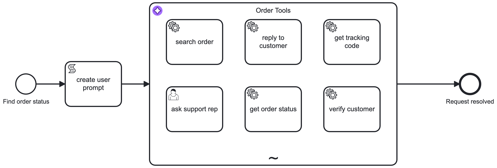

# Agentic Orchestration Use Case

## Description

This use case shows how an ai connector orchestrates a set of tools to detect an order status



## Tools

- AWS Bedrock with Anthropic Claude Opus 4.6
- Custom Java Workers for Order information
- Camunda SaaS (8.10)

## Running the workers

Requirements: JDK 25 and the client credentials of a Camunda 8.10 cluster in `src/main/resources/application.properties`.

```shell
export JAVA_HOME=/path/to/jdk-25
./mvnw spring-boot:run
```

The app starts the job workers and the support console at <http://localhost:8080>.
To look at the data without connecting to Camunda, start it with `--camunda.client.enabled=false`.

### Job workers

| Job type            | Input variable  | Returns                                                                    |
|---------------------|-----------------|----------------------------------------------------------------------------|
| `verify-customer`   | `customerInfo`  | `customerExists`, `customerId`, `nameMatches`, `tier`, `message`           |
| `search-order`      | `orderInfo`     | `found`, `outcome`, `orderId`, `candidates`, `message`                     |
| `order-status`      | `orderId`       | `orderStatus`, `statusDescription`, `items`, `total`, `trackingAvailable`… |
| `get-tracking-code` | `orderId`       | `trackingStatus`, `trackingNumber`, `provider`, `arrivalTime`, `lastEvent`… |
| `inform-customer`   | `statusMessage` | `deliveryStatus`, `channel`, `recipient` (masked), `sentAt`, `message`     |

Ids are normalized, so `10002`, `ord 10002` and `ORD-10002` find the same order, and `1001` finds customer `C-1001`.
Placeholders such as `null` or `n/a`, which the agent sends for missing values, are treated as empty.

### Support console

A read-only UI for the human support agent who handles the `ask support rep` task:
dashboard with orders that need attention, customers, orders with items and tracking timeline,
and a live feed of the notifications the AI agent sent. The search box (`/`) jumps straight to an
order id, customer id or tracking number. It has no authentication and only listens on `127.0.0.1`.

### Mock data

Customers and orders are defined in `src/main/resources/data/*.json` and loaded into an in-memory H2
database on every start; all changes are lost on restart. Dates in the JSON are relative to now
(`orderedDaysAgo`, `shippedHoursAgo`, …) so the data never goes stale. The startup log lists every order
with its resolved order date.

### Code structure

Packages are organized by feature. Workers and controllers only delegate, the business logic lives in the services.

```
com.consid.bpm.agentic
├── customer       customers and the verify-customer logic
├── order          orders, order search and status
├── shipment       shipments and tracking
├── notification   mock notification gateway
├── common         input normalization shared by the features
├── worker         Camunda job workers (tools of the AI agent)
├── console        support console (Spring MVC + Thymeleaf)
└── mockdata       loads the JSON mock data on startup
```

## AWS Todos

- AWS Bedrock -> Request Model Access
- AWS IAM -> With Role `AmazonBedrockFullAccess`
- Security Credentials (Access Key, Secret Access Key)
- Pro Tip: Deactivate Credentials when not using them (`IAM` > `User` > `Security Credentials`)
- Pro Tip: Set a budget for your AWS account to keep costs under control (`Billing and Cost Management` > `Budget`)
